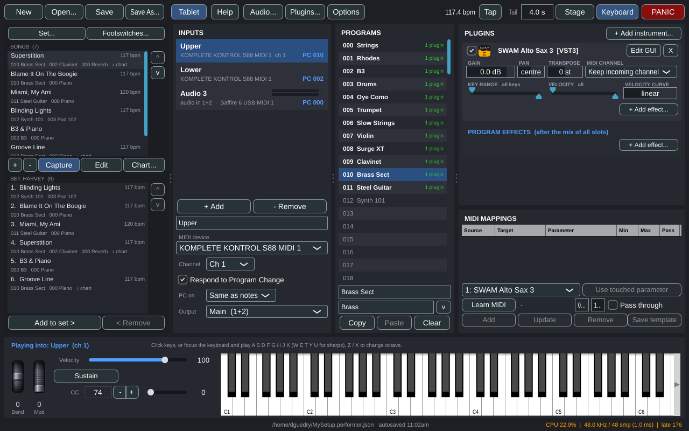

# StageRig

**A live-performance plugin host for Linux -- for keyboards and for audio.**
Point your keyboards at it and it plays instruments; plug a microphone, a
guitar or a hardware synth into your audio interface and it runs them through
effects. Build a program for each sound in your show, and change sounds from
the keyboard or a footswitch while you play -- or from a tablet on a music
stand, with no app to install.

And not just the sounds: any plugin you have loaded can be opened and **fully
operated** from that tablet, laptop or phone -- its own interface, mirrored,
with every knob, drawbar and menu live under your finger. Pull a drawbar on the
tablet and the organ on stage moves.

<p align="center">
  
</p>

StageRig exists because the live hosts keyboard players rely on -- MainStage,
Gig Performer, Cantabile, Camelot -- have no Linux version. It hosts **VST3**,
**CLAP**, **LV2** and **LADSPA** plugins natively, and Windows VST3s and CLAPs
bridged with [yabridge](https://github.com/robbert-vdh/yabridge) work like any
other plugin.

- **MIDI inputs and audio inputs, side by side.** An input is a keyboard (a
  MIDI device and channel) or an audio source (one or two of the interface's
  input channels). Each has its own 128 programs, selected by MIDI Program
  Change while you play: Upper and Lower manuals change independently, and a
  vocal mic or a guitar steps through its effects from a footswitch the
  same way. Group programs by kind -- organs, strings, brass -- to find things
  quickly.
- **Keyboards play instruments**, with splits and layers: per-instrument key range,
  velocity range, velocity curve, transpose, gain and pan, and the MIDI
  channels each instrument takes notes from, so one program can sort a
  multi-channel keyboard or a MIDI file into its parts.
- **MIDI devices too.** An instrument can be a hardware synth or a lighting
  controller on a MIDI port -- with patch recall when the program is
  selected, and a synth's audio back through the interface into the
  program's effects and outputs.
- **Every instrument is a chain.** MIDI effects (arpeggiators, chord
  generators) before it, audio effects after it, and any MIDI device that
  should play along.
- **Audio runs through effects.** An audio input's programs are effects
  with an input trim -- reverb on the vocal for the ballad, drive on the guitar
  for the solo -- and a level meter on the laptop and on the tablet. Effects
  get MIDI too, so a vocoder or harmoniser plays from the keyboard.
- **Insert effects** per instrument and per program.
- **Outputs on the interface's channels.** Each input lands on an output -- a
  pair of the interface's output channels -- so the keyboards, the vocal and
  the guitar can reach the desk on separate channels; every output has a
  master effects chain and a volume you can put on a pedal.
- **MIDI learn** for any plugin parameter, with suggested mappings from
  parameter names and reusable per-plugin templates.
- **Every plugin in its own process.** A plugin that crashes or hangs takes
  only itself down; the rest of the rig plays on.
- **Built for low latency**: a native PipeWire/JACK client, 128-sample blocks
  by default, parallel plugin loading, and a late-block counter you can watch.
- **Loop a passage** on a keyboard from a footswitch, in whole bars at the rig's tempo, and play over it.
- **Sections carry a cue sheet**: entering the chorus can change a keyboard's program, mute a part, bypass an effect or cue the lights.
- **Built-in MIDI effects**: an arpeggiator, a chord, a scale, a run and a big band (each key plays the chord on that step of the key, voiced as you set it), following the song's key, with nothing to install.
- **A pedal for a layer or an effect**: mappings can switch an instrument or an effect, or be its level; one knob can move several things.
- **Backing tracks follow the song's tempo and key**: find the tempo in the audio, and the files stretch and transpose with the song.
- **Record the gig**: every output to WAV as it left for the desk, and the keyboards to a MIDI file, in a dated folder beside the setup.
- **Ableton Link**: the tempo and the beat shared over the network with Live, Bitwig, DJ software and loop apps; Play waits for the shared bar.
- **A global tempo with tap tempo** and **MIDI clock out** to hardware, so tempo-synced delays and arpeggiators
  have something to sync to. Tap it in the toolbar or from a footswitch.
- **An on-screen keyboard** for building a setup without a controller attached.
- **Tablet control -- the whole plugin, not a remote control for it.** A
  built-in web app changes programs from a music stand, and opens any loaded
  plugin's own interface on the tablet, laptop or phone: the real editor,
  mirrored and fully interactive, so you can reach a Kontakt library's every
  page or a B-3X's drawbars without walking back to the computer. Nothing to
  install -- scan the code or type a short one, and add it to the home screen if
  you like. StageRig can serve its own wifi network when the venue has none.
- **Backing tracks.** A song can carry audio files -- a full mix, or drums,
  bass and pads apart, plus a click and cues for the in-ears -- each on its
  own output, and MIDI files whose parts each play on what you choose: the
  built-in General MIDI player (FluidSynth), one of your own programs by
  keyboard and by name (*Upper: Big Strings*, kept playing whatever Upper
  itself is on), or a MIDI device. A piano roll edits the notes. With a
  count-in and a click for the in-ears, started and stopped from a footswitch, the laptop or the tablet,
  where parts can be muted from the stand. Mark its sections on a timeline of
  the files' waveforms and notes, jump between them in time, and vamp an
  intro until a pedal lets it go on. Tempo-synced
  effects lock to the track.
- **Charts on the stand.** Attach a lead sheet, a scan or a chord chart to a
  song -- PDF, image, text or ChordPro -- or type a chord chart in the app,
  with the page beside the text -- and the tablet shows it, turning
  PDF pages a tap at a time and following the set list from song to song. Files
  are kept in a folder beside the setup, so the two travel together.

**[Read the user manual](https://github.com/dguedry/stagerig/blob/main/docs/MANUAL.md)** for everyday use, or press **Help**
in the toolbar to read the same manual inside the app. The rest of this
file is for building from source and for how the program works inside.

Requires Linux, JUCE 8 (fetched as a submodule) and a C++17 compiler.
Licensed under the [GPL-3.0](LICENSE).

## Concepts

| Term | Meaning |
|------|---------|
| **Input** | A keyboard (a MIDI device plus an optional channel filter), an audio input (device channels, with a MIDI device for program changes and pedals), or the **Backing track** -- the songs' MIDI files, which play instruments as a keyboard would. Each input has its own current program. Two inputs may share one device (e.g. channel 1 = Upper, channel 2 = Lower). |
| **Program** | One of 128 per input, selected by MIDI Program Change, a click, a song, a footswitch or the tablet. Holds instruments and MIDI mappings. |
| **Instrument** | One instrument inside a program -- a plugin, a MIDI device (hardware synth, lights) on a port, the built-in General MIDI player, or another keyboard's program -- with enable, gain, pan, transpose, key range, velocity range, velocity curve and the channels it takes notes from, plus its MIDI chain and effects. Key and velocity ranges make splits and touch-switched layers; the curve matches a controller's feel to a library. |
| **Effects** | Ordered effects with bypass. Each instrument has its own (MIDI chain → instrument → effects → gain), the MIDI chain holding MIDI effects and sends to MIDI devices; the program's **PROGRAM EFFECTS** work on the sum of all instruments. Effects receive the same MIDI as their instrument. |
| **Mapping** | A CC / pitch-bend / aftertouch message → one parameter on any instrument or effect, scaled between min and max. Optionally also passed through to the plugin. |
| **Output** | A pair of the interface's channels with a master effects chain and a volume. Every input lands on one; the default setup has one, "Main", on channels 1-2. |
| **Song** | What to load for one number: a program per input, a tempo, stage notes, charts, and its backing track -- audio and MIDI files with sections and vamps. A MIDI file's **parts** (its channels) each play on an instrument of the song's program on the Backing track input. |
| **Set list** | Songs in order, stepped from a footswitch or the tablet. (Called a set list everywhere, because in Ableton Live a *Set* is the file.) |
| **Setup** | The whole document (inputs, outputs, programs, songs, set lists, plugin states). Saved as `*.stagerig.json`, with the songs' charts and track files in a `.charts/` folder beside it. |

If you know Ableton Live: a Live *Set* is StageRig's setup file; a MIDI
track with its device chain is an **input** with the **program** it is on;
a Rack's zones are a program's instruments with their key and velocity
ranges; a scene per song is a **song**; locators are **sections**. The manual
has the full table (*If you know Ableton Live*).

A program change leaves what you are holding to the previous program: keys
down and the sustain pedal keep sounding there until you let go, and then a
configurable release tail lets it ring out, so a pad held under the change or a
pedal down over the bar line is never cut. With **Preload all programs (instant changes; uses more memory)** on,
every used program stays loaded and changes are instant (at the cost of RAM).

## Install

**[Download the latest release](https://github.com/dguedry/stagerig/releases/latest)**
— a `.deb` for Debian/Ubuntu and an `.rpm` for Fedora, both x86-64. They install
`StageRig` and `stagerig-plugin-host` into `/usr/bin`, plus a launcher entry
and the icon.

Verified on Ubuntu 24.04, Linux Mint 22.3 (Cinnamon) and Fedora 43, with native
LV2/VST3 plugins and Windows plugins bridged through
[vstenv](https://github.com/dguedry/vstenv).

The package filename carries the version, so fetch whichever the latest release
lists rather than hard-coding a number:

```sh
# Debian / Ubuntu
gh release download --repo dguedry/stagerig --pattern '*.deb'
sudo apt install ./stagerig_*_amd64.deb

# Fedora
gh release download --repo dguedry/stagerig --pattern '*.rpm'
sudo dnf install ./stagerig-*.x86_64.rpm
```

Without the GitHub CLI, open the releases page above and download the file
directly; both packages are attached to every release.

StageRig ships no plugins but the General MIDI player; the packages suggest a
set of free ones good enough to gig with -- Surge XT, setBfree, ZynAddSubFX,
AVL Drumkits, Dragonfly Reverb, LSP, x42, Calf, Guitarix, ZamAudio:

```sh
sudo apt install surge-xt setbfree zynaddsubfx-lv2 avldrums.lv2 dragonfly-reverb \
                 lsp-plugins-lv2 x42-plugins calf-plugins guitarix-lv2 zam-plugins
```

The manual's *Good free plugins to start with* says what each is for, gives
the Fedora line, and lists the ones worth fetching from their own sites.

Every push also builds both packages as workflow artifacts under
[Actions](https://github.com/dguedry/stagerig/actions), if you want a
build from `main` rather than the last release.

For plugins you will also want `calf-plugins` (or any LV2/VST3 instruments),
`pipewire-jack` for the low-latency audio path, and
[yabridge](https://github.com/robbert-vdh/yabridge) for Windows plugins.
[vstenv](https://github.com/dguedry/vstenv) sets up the Wine side and bridges
Windows plugins (Native Instruments, Steinberg, iZotope and others) into the
folders StageRig scans, if you would rather not configure Wine and yabridge by
hand.

## Build

Requirements (Ubuntu 24.04 names): `build-essential cmake ninja-build
libasound2-dev libjack-jackd2-dev libx11-dev libxrandr-dev libxinerama-dev
libxcursor-dev libfreetype-dev libfontconfig1-dev libgl1-mesa-dev ladspa-sdk`.

```sh
git clone --recurse-submodules https://github.com/dguedry/stagerig.git
cd stagerig
# if you cloned without --recurse-submodules:
git submodule update --init --depth 1 external/JUCE

cmake -S . -B build -G Ninja -DCMAKE_BUILD_TYPE=Release
cmake --build build
./build/StageRig_artefacts/Release/StageRig            # opens the last setup
./build/StageRig_artefacts/Release/StageRig my.stagerig.json
cmake --install build --prefix ~/.local                  # optional: binaries, launcher entry and icon
```

## Using it

See the **[user manual](https://github.com/dguedry/stagerig/blob/main/docs/MANUAL.md)**: inputs and keyboards, programs,
instruments, splits and layers, effects, MIDI mappings, the on-screen keyboard, audio
settings and latency, live checklist, troubleshooting and the files StageRig
uses.

The short version: **Audio...** to pick an output, **Plugins...** to scan for
plugins, select an input and give it a MIDI device, click a program, press
**+ Add instrument...**, then **Save As...**.

## Tablet control

**Tablet** in the toolbar starts a small web app on your network, for picking
programs from a music stand instead of the laptop.


The Programs tab is the same page's other half -- every program on every
keyboard, grouped, with a GUI button per input:


Scan the square code with the tablet's camera, or type the address and the
six-character code. The code survives a restart, so a home-screen shortcut keeps
working, and **Options ▸ Print the program list (for the stand)...** puts the same scannable code on the printed program
sheet.

### The plugin itself, on the stand

The tablet opens on the set list: the song you are on in large type with what
each keyboard is playing, the rest of the running order underneath, and a search
once there are enough songs to need one.

**GUI** beside each input's program puts that plugin's own interface on the
tablet -- not a picture of it, but the working editor:


Everything works: pull those drawbars, kick the Leslie from slow to fast, open a
menu, load a different patch. Input travels back to the plugin, so the tablet is a
second screen and mouse for it rather than a remote with a fixed set of buttons.
A laptop or phone on the same network does the same job -- it is a web page, so
whatever you point at it is a full editor for every plugin in the rig.

That matters most for plugins nothing else can reach. StageRig used to offer
faders you picked and labelled per plugin; they are gone, because they could not
tell the truth. Kontakt's host-visible parameters are MIDI controller inputs --
values go in and nothing comes back -- so a fader on the tablet could drive an
organ but never follow it when you moved a drawbar in the plugin itself.
Mirroring the real editor sidesteps that, and needs no setting up per plugin:
whatever the plugin shows is what you get.

A touch holds for as long as your finger does, so the plugin's own keyboard
plays properly -- one finger at a time, since the mirror is a single pointer. **+**/**-** and **Fit to screen** handle zoom, **Move view**
switches to panning and pinching, and **Full screen** hides the browser's address bar.
Taps arrive on the computer as real clicks, so the plugin window must not be
covered by another window there -- StageRig keeps it above everything else for
as long as a tablet is looking at it. Each plugin gets its own tab, named after the
program. Needs `x11vnc`, `websockify`, `xdotool` and `novnc`, and works on
Wayland desktops as well as X11 ones -- StageRig and plugin editors are X11
windows, so they run through XWayland, which `x11vnc` reads and writes
normally. A Wayland session with no XWayland is the one case that does not
work, and StageRig says so rather than showing a black screen.

With a song selected, the Set list tab carries **Play** / **Stop**, the track's
sections (tap one to go there when the current one ends, or **End vamp ▸** to let a vamp go
on), and **Parts of the track** -- the MIDI files' parts, each with what plays it, a
**Mute** for the one you will play yourself tonight, and **GUI** when a
plugin in the song's own program plays it.

If the tablet cannot connect, the usual cause is a firewall on the computer
rather than anything else; the desktop can still open the address itself, which
makes it look like the tablet is at fault. Open the port for private networks
only:

```
sudo ufw allow from 192.168.0.0/16 to any port 7777 proto tcp
sudo ufw allow from 10.0.0.0/8 to any port 7777 proto tcp
sudo ufw allow from 172.16.0.0/12 to any port 7777 proto tcp
```

No wifi at the venue? **Create a wifi network** makes the computer serve its
own, which the tablet joins directly. StageRig asks once which wifi adapter to
use and remembers it; a spare USB adapter lets the machine stay on its normal
network at the same time. See the [manual](https://github.com/dguedry/stagerig/blob/main/docs/MANUAL.md) for the details.

## Windows plugins via yabridge and vstenv

Windows VST3s and CLAPs bridged with yabridge appear as normal plugins of that
format, and StageRig does not care how the Wine side was set up. yabridge
bridges both, so a Windows CLAP is scanned from `~/.clap/yabridge` and hosted
like any other -- its own window and all.

[vstenv](https://github.com/dguedry/vstenv) is the easy way to get one: it
provisions its own Wine, installs each vendor's manager application (Native
Access, IK Product Manager, Steinberg Download Assistant, Audio Modeling
Software Center) and the products they deliver, and bridges the result into the
folders StageRig scans. A prefix it manages records which wine belongs to it,
and vstenv teaches `yabridge-host.exe` to read that record -- so the right wine
is used whatever starts the plugin, with nothing on `PATH` and nothing set in
the session. StageRig needs to do nothing special for it.

For a prefix set up by hand, StageRig also follows the older convention:
`~/.local/bin` goes first on a helper's `PATH` when a `wine` shim is
there, and variables from `~/.config/environment.d/*.conf` (`WINELOADER`,
`WINEFSYNC`) are applied when the session lacks them. That matters because a
desktop launcher and a terminal do not always agree about the environment.

While a vendor's installer replaces a plugin file, the yabridge bundle briefly
points at nothing. StageRig reports that as "yabridge link points to a missing
file" rather than blacklisting the plugin; once the install finishes and
`yabridgectl sync` has run, scan again and the plugin comes back.

## Process model

Every plugin runs in its own `stagerig-plugin-host` process. StageRig talks to
each one over a shared-memory block (audio, MIDI and parameter changes, one
block at a time, with two semaphores) plus a socket for everything that is not
real-time: loading, state, parameter lists, editor windows and notifications.

- A plugin that crashes takes only its own process down. The instrument goes silent,
  the UI marks it red, and its **Reload** button starts a fresh process with
  the saved state.
- A plugin that hangs (a stuck editor, a bridge waiting on Wine) can't freeze
  StageRig: requests to it time out, and the audio thread waits for each
  process only until 85 % of the block period has passed. Late blocks are
  counted in the status bar as "late N".
- Plugin editors are windows of the host process, so they survive independently
  of StageRig's UI. Instruments of one program render in parallel, one process
  per core; effect chains run in order.
- Plugin scanning also happens in helper processes (`stagerig-plugin-host --scan`),
  so a crashing plugin can't kill the scan.

The helper is looked for next to the `StageRig` executable, then in the build
tree, then via `$STAGERIG_PLUGIN_HOST`.

## Layout of the code

- `Source/Model.*` – the document (`Setup → InputDef → ProgramDef → SlotDef / MappingDef`) and JSON persistence.
- `Source/PluginHost.*` – plugin formats, known-plugin list, out-of-process probing, mapping templates.
- `Source/PluginScanner.*` – app-owned background scan; `Source/PluginManagerComponent.h` – the Plugins window.
- `Source/MappingSuggestions.*` – per-plugin mapping templates and name-based CC suggestions.
- `Source/PluginIcons.*` – plugin icons: Windows PE icon resources, VST3 snapshots, generated badges.
- `Source/Engine.*` – audio/MIDI engine: device management, program loading and switching, MIDI routing, mappings, learn.
- `Source/RemotePlugin.*` – host-side proxy for one plugin process (spawn, control channel, real-time block exchange).
- `Source/Ipc/Protocol.*` – shared-memory layout and framing shared by both executables.
- `Source/PluginHostProcess/PluginHostMain.cpp` – the `stagerig-plugin-host` executable.
- `Source/MainComponent.*` – the UI (inputs, programs, slots, mappings panels).
- `Source/KeyboardPanel.h` – on-screen keyboard and test controllers.
- `Source/ParamPicker.h` – searchable parameter picker; `Source/AudioSettingsComponent.h` – the Audio window.
- `Source/LowLatency.*` – PipeWire JACK preload, quantum control, realtime checks.
- `Source/Main.cpp` – application entry.

## Tests

```sh
ctest --test-dir build
# Optionally exercise a specific VST3 (e.g. a yabridge-bridged plugin) through the engine:
STAGERIG_TEST_VST3="$HOME/.vst3/yabridge/Kontakt 8.vst3" ./build/EngineTest_artefacts/Release/EngineTest
```

All plugin buses are kept active and rendered into a full-size buffer; only the
main bus is mixed. Disabling aux buses makes JUCE pass null channel pointers,
which crashes plugins that write to them regardless (Kontakt via yabridge).

Settings live in `~/.config/StageRig/`.

## Low latency (live use)

StageRig is meant to be played live, so it goes for the smallest safe block:

* It loads PipeWire's JACK client library itself (`pipewire-jack`, package
  `pipewire-jack` on Debian/Ubuntu), so it does not need to be started with
  `pw-jack`, and it defaults to the **JACK** device type at 48 kHz. That makes
  StageRig a direct node in the PipeWire graph; the ALSA type goes through
  PipeWire's ALSA emulation with its own buffering and resampling.
* **Audio...** has a **LATENCY** section: the buffer size to ask
  for (default 128 samples = 2.7 ms at 48 kHz; 64 if the machine is quiet) and
  **Make the whole system use this buffer size while StageRig runs**. With that on,
  StageRig forces the PipeWire graph to that quantum at start
  (`clock.force-quantum`) and restores the previous value when it quits, so
  the desktop's `min-quantum`/`default.clock.quantum` settings do not get in
  the way. The status bar shows the block size actually delivered and the
  resulting latency.
* **Another application can hold the clock.** Bitwig Studio, for example,
  forces `clock.force-quantum` to its own block size every few seconds while
  it runs; StageRig then reports *clock held by another app* in the status
  bar. Close that application or set its block size to StageRig's.
* **Realtime scheduling.** Small blocks only stay glitch-free when the audio
  thread can run at realtime priority. Check `ulimit -r`: if it prints 0, add
  yourself to the `pipewire` group (`sudo usermod -aG pipewire $USER`, then
  log out and back in) or otherwise grant `rtprio`/`memlock` in
  `/etc/security/limits.d/`. The Audio dialog reports whether realtime
  scheduling is available.
* Plugins load in parallel (half the machine's threads, 4 to 12, by default; `parallelLoads` in
  `~/.config/StageRig/StageRig.settings` changes it), so *Preload all
  programs* fills a setup quickly. Wine-bridged plugins load in parallel too
  (`parallelBridgedLoads`, default the same); two Kontakts starting together on
  a cold prefix both come up in the time one takes. If a machine stalls on
  concurrent Wine start-ups, `bridgedColdStartSolo=1` starts the first bridged
  plugin alone when no wineserver is running yet.
* Every plugin runs in its own process; a plugin that does not finish its
  block in time is silenced for that block and counted as *late* in the
  status bar, so one slow plugin cannot stall the whole rig.

## Releasing

Tag a version and push it; the *Packages* workflow builds the `.deb` and
`.rpm` with that version, runs the tests, creates the GitHub release with
generated notes and attaches both packages:

```sh
git tag v0.2.0 && git push origin v0.2.0
```

Local packages: `cmake --build build && (cd build && cpack -G DEB)` or `-G RPM`
on a machine with `rpm-build`.

## Contributing

Issues and pull requests are welcome. Please run the tests before opening a PR:

```sh
cmake --build build && ctest --test-dir build
```

Two things worth knowing before changing the engine: nothing may block the
audio thread (plugin calls go through the shared-memory block with a deadline),
and nothing may block the message thread on a plugin (loading happens on the
loader pool, and every plugin call from the UI has a timeout). `Tests/EngineTest.cpp`
runs real plugins through real helper processes and is the place to add
coverage.

## License

GPL-3.0-or-later. See [LICENSE](LICENSE).

JUCE is included as a submodule and carries [its own licence](https://github.com/juce-framework/JUCE/blob/master/LICENSE.md):
JUCE 8 is offered under the AGPLv3 or a commercial licence, and StageRig uses it
under the AGPLv3. GPLv3 section 13 allows the two to be combined, so a StageRig
binary is distributed under the GPLv3 for StageRig's own code and the AGPLv3 for
JUCE's. The CLAP headers are MIT-licensed. [Ableton Link](https://github.com/Ableton/link)
is included as a submodule under its GPLv2-or-later licence (it is also
offered commercially by Ableton), together with the standalone Asio library it
uses, under the Boost Software License.

Packaging for distributions: see [docs/PACKAGING.md](https://github.com/dguedry/stagerig/blob/main/docs/PACKAGING.md).
